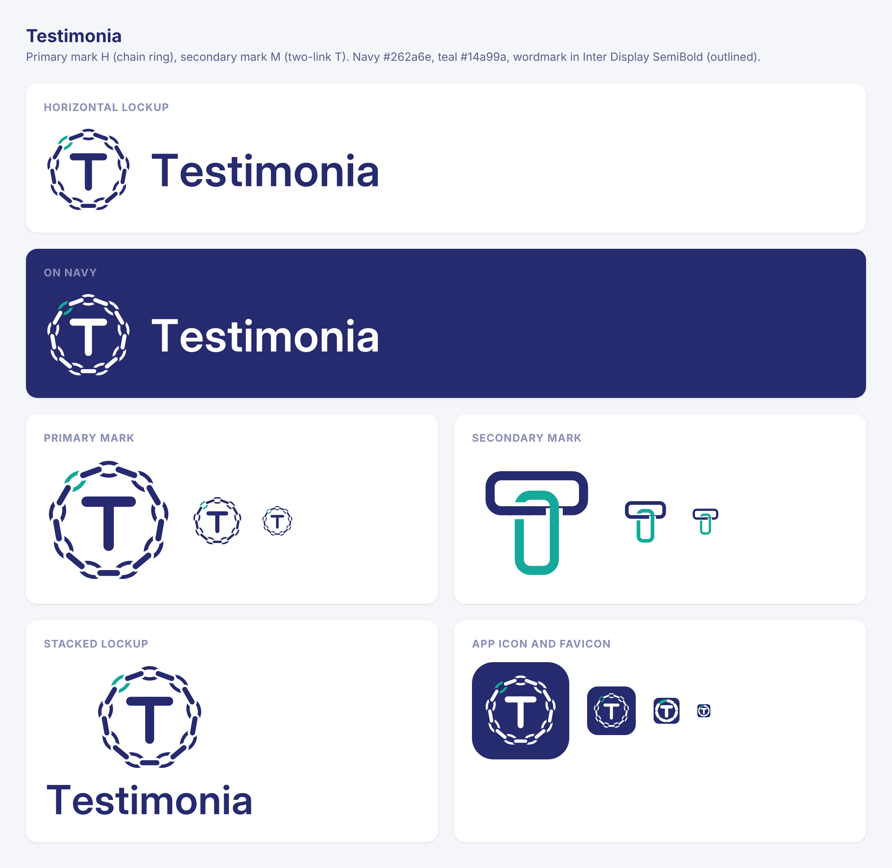

# Testimonia brand

**Testimonia** (Latin for "testimonies, evidence") is the working name for the attestation
service and capture app. Not yet cleared as a trademark: check USPTO classes 9 (software)
and 42 (online services) before registering or using it commercially.

## Marks

| | File | Use |
|---|---|---|
| **Primary: chain ring (H)** | `final/testimonia-mark.svg` | Everywhere by default. A ring of chain links, one in teal for the newest record, around the T. |
| **Secondary: two-link T (M)** | `final/testimonia-chain-t.svg` | Where the T stands alone: avatars, merchandise, large headers. Two rounded-rectangle links, like the ring's, hooked into a T. |

Each has a `-white` version for dark backgrounds.

The secondary mark is drawn by `make-square-t.py`; other T options (J, K, L) are kept for reference.

## Lockups and icons (`final/`)

| File | What |
|---|---|
| `testimonia-lockup.svg` | Mark and name side by side |
| `testimonia-lockup-stacked.svg` | Mark above the name |
| `testimonia-wordmark.svg` | Name alone |
| `testimonia-app-icon.svg` | White mark on a navy rounded square |
| `testimonia-favicon.svg` | Simplified ring of 8 heavy segments around the T: at 16-32 px the chain links blur, so this keeps H's outline |
| `png/` | App icon (1024, 180), favicon (32, 16), marks (512), lockups (1200) |

## Colours and type

- Navy `#262a6e` and teal `#14a99a`, the same as Promissa, so the two read as one family.
- Wordmark: Inter Display SemiBold (SIL Open Font License), converted to outlines, so it
  doesn't depend on installed fonts.

## Rebuilding

`python3 make-final.py` regenerates everything in `final/` (needs `pip install fonttools` and
the Inter Display font). The mark shapes are defined in `make-chain.py`. Earlier options
(A to G, I) are in `drafts/`.
