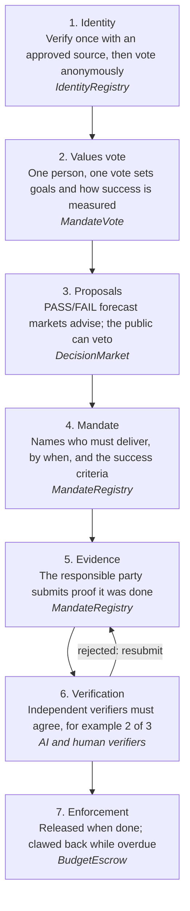
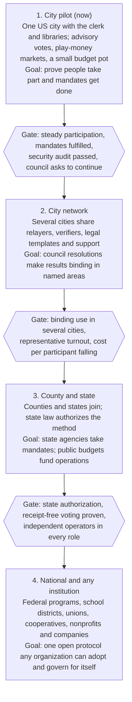

# Mandate: Scaling Plan

*The people decide. The protocol makes sure it happens.*

As of 2026-11-09. A shareable, editable copy of this plan is kept alongside the repo.

## Summary

Mandate gives people a direct, private, enforceable say in the institutions that govern them, starting with one US city and scaling to any government or organization.

Today a vote ends when the ballots are counted, and nothing checks whether the decision was carried out. Mandate closes that loop. Each public decision becomes a **mandate** with a responsible party, a deadline and success criteria. Independent verifiers check the evidence, and funds tied to the mandate are released, refunded or clawed back automatically.

People verify their identity once, then vote anonymously from a phone, computer, kiosk or printed card, with no crypto wallet needed. Prediction markets on play money advise on which proposals will meet the public's goals, and the public keeps a veto. A working prototype exists, with 31 automated tests, and is ready for a pilot city partner.

## Principles

Every design choice at every stage of scale is held to these six rules.

1. **One person, one vote.** Influence over decisions never scales with money, reputation or time spent.
2. **Capital funds and enforces, never decides.** Money can back a mandate, bond a proposal or stake on a forecast. It never counts as a vote, and stakes are capped per person.
3. **Verify once, vote privately.** Identity is checked once by an approved source. Ballots are zero-knowledge proofs, so no one can see how any person voted.
4. **Markets advise, people decide.** Forecast markets recommend; the public can veto any recommendation.
5. **No single operator.** Identity sources, verifiers, relayers and kiosks are run by independent parties, so no one can capture or censor the system.
6. **Prove it small, then grow.** Play money and advisory votes come before real funds and binding effect. Each stage must earn trust before the next.

## How it works today

A public decision moves through seven stages, each handled by its own open-source contract or service, and the prototype implements all of them.

Rejected evidence goes back to the responsible party to resubmit, and the deadline keeps running.

## Participation for everyone

Anyone eligible can take part through at least one channel, with no crypto knowledge, and a wallet stays optional.

| Channel | How it works | Who it serves | Privacy |
| --- | --- | --- | --- |
| Phone app | Web app; the voting secret is unlocked with a passkey (Face ID, fingerprint, PIN) | Most residents | Highest: proof built on the device |
| Computer | The same web app in any browser; the passkey syncs across the person's devices; a mobile ID is shared by scanning a QR code with the phone | People who prefer a larger screen | Highest |
| Printed voter card | A QR card scanned at a kiosk or a library webcam | No smartphone | High: nothing saved after use |
| Kiosk | Library and city-hall terminals, with assisted enrollment | No device, or needs help | High: open-source, audited kiosk software |
| Phone call | An AI phone line reads proposals; a PIN-unlocked custodial service casts the vote | Low vision, no internet | Lower: the custodian could see choices, so it is audited and voters get receipt codes |

**Wallets are optional.**

- Voting needs no account: a ballot is a proof, and a relayer submits it and pays the fee.
- Holding play credits, backing a mandate or collecting market winnings uses an account created automatically on first use. Its key is the person's passkey, fees are sponsored, and the person can move to their own wallet at any time.
- People who already use crypto can connect their own wallet.
- The voting secret and the money account are never linked publicly, so backing a mandate never reveals how someone voted.

**Access paid for by the public.** Once the pilot proves out, residents can vote the access infrastructure into place as ordinary mandates: device lending through libraries, kiosks, assisted-voting centers and broadband. Everyday participation (comments, advisory polls, markets, backing) stays always open. Binding votes run in scheduled decision windows, such as one week a month, so there is time to deliberate and to avoid fatigue.

## Stages of scale

Mandate grows in four stages, and each must pass a gate of real-world results before the next one starts.

The same open protocol serves every stage; what changes is who adopts it, how much legal force results carry, and who runs the infrastructure.

## Decentralizing operations

Every role that could be a choke point is run by several independent parties, and the public vote decides who those parties are.

| Role | What it does | Run by (pilot) | Run by (at scale) | Safeguard |
| --- | --- | --- | --- | --- |
| Identity source | Checks documents, enrolls people | City clerk, a mobile-ID verifier, a phone check | Any accredited clerk, DMV, university, union or cooperative | Approved and removable by vote; every enrollment is traceable to its source |
| Verifier | Checks evidence that a mandate was met | AI verifier, a civic auditor, a dispute-court adapter | Competing verifier networks | A threshold must agree, for example 2 of 3; no single verifier decides |
| Relayer | Submits ballots and pays fees | City, library system, a civic nonprofit | Anyone who stakes a bond to run one | Proofs can't be altered; voter apps fail over to another relayer |
| Kiosk operator | Assisted enrollment and voting | Libraries | Libraries, community centers, schools | Open-source, reproducible builds; nothing stored |
| Protocol upgrades | Changes the contracts and rules | Admin key held by a timelock | A timelock controlled by the public vote | Every change is delayed and public before it takes effect |

**Who governs the protocol itself.** Early on, a small founding group holds upgrade rights behind a timelock. Those rights pass to a vote of all participating communities as the network grows. Each community also keeps the right to leave, by forking the open-source code and its own records.

## Contribution economy

People who give time and skill to carrying out mandates are paid for verified work, but contribution never buys extra votes.

A mandate can carry **paid tasks**, funded from its escrow and paid out when the work is verified. Examples:

- reviewing evidence as a verifier,
- translating proposals and summaries,
- moderating deliberation sessions,
- running a relayer or a kiosk,
- doing the work itself: clearing a backlog of records, auditing a budget, building a public dataset.

Contributors build a **private track record**: a credential showing tasks completed and accuracy, which they can prove without revealing their identity. It can qualify someone for harder tasks or for verifier roles, never for more voting weight.

Protections for contributors:

- Pay is set and escrowed before work starts, and released automatically on verification.
- Disputes over completed work go to an independent dispute process, not to the party that would pay.
- Paid tasks follow local labor law; this is not a way to replace public employees with unprotected gig work.
- Rates are public, so the same task pays the same for everyone.

## Funding model

Funding shifts from grants to public budgets as each stage proves itself, ending with communities voting their own operating budget through mandates.

| Stage | Main sources | What it pays for |
| --- | --- | --- |
| City pilot | Civic-tech and democracy foundations; a small city innovation budget | Audit, issuer services, voter app, kiosks, outreach |
| City network | Shared-cost membership fees per city; matching grants | Shared relayers and verifiers, support team, legal templates |
| County and state | Line items in public budgets, approved by elected bodies | Operations, accessibility programs, device lending |
| National and institutions | Budgets voted through mandates; fees from organizations that adopt it | Protocol upkeep, security, the contributor pool |

Operating costs are low per participant: ballots on an Ethereum layer-2 network cost cents in fees, paid by relayers. The real costs are people: outreach, support, audits and legal work. Exact figures need a costed budget with the pilot city.

## Legal path

Authority grows in four legal steps, each one granted by the existing system rather than taken from it.

1. **Advisory.** Results are published and tracked publicly; no legal force. Needs no change in law.
2. **Council resolution.** The council commits by resolution to act on results in named areas, such as a participatory-budget pot or records releases. Revocable by the council.
3. **Charter amendment.** Voters amend the city charter to make certain results binding, under the city's existing ballot-initiative process.
4. **State law.** States authorize the method for counties and cities, and for state agencies' mandates.

Regulatory items to clear with counsel before each step:

- **Prediction markets:** real-money markets on event outcomes fall under CFTC rules; stay on play money until counsel clears an alternative.
- **Election law:** binding votes must satisfy state rules on eligibility, accessibility and records retention.
- **Biometrics and identity data:** state laws such as Illinois' BIPA; issuers delete raw data after checks.
- **Public funds in escrow:** state rules on how and where public money may be held.
- **Records and open-meetings laws:** deliberation and results must remain public records.

## Technology roadmap

Phases one and two are built and tested; phase three is what a pilot city needs before launch.

| Phase | Components | Status |
| --- | --- | --- |
| 1. Core loop | Mandate registry; budget escrow; decision markets on play money; AI evidence verifier; verifier node; dashboard | Built, tested |
| 2. Identity and private voting | Identity registry with tiers and seasoning; zero-knowledge ballots; frozen voter lists; proposal bonds; ballot relayer | Built, tested with real proofs |
| 3. Pilot readiness | Passkey web app for phone and computer with optional automatic accounts; clerk-desk enrollment app; mobile-ID and phone-check services; per-person market caps; handing admin control to a vote-controlled timelock | In progress |
| 4. Hardening | Receipt-free encrypted ballots (MACI) so votes can't be sold; dispute-court adapters; kiosk mode and printed cards; phone-call voting; external security audit | Planned |
| 5. Network | Many communities on shared infrastructure; contributor task marketplace; staked relayer and verifier networks; cross-community standards | Planned |

## Risks and mitigations

The biggest risks are social and legal, not technical: low turnout, capture by organized groups, and leaving people out.

| Risk | What could happen | Mitigation |
| --- | --- | --- |
| Vote buying and coercion | A voter proves their vote to a buyer or an employer | Receipt-free encrypted ballots (MACI) in phase 4; binding votes wait until then |
| Capture by organized groups | A motivated minority dominates low-turnout votes | Quorums; scheduled decision windows; public veto; deliberation before votes |
| Wealthy influence | Money swings markets or floods proposals | Votes never weighted by money; per-person stake caps; time-averaged market prices; refundable bonds only |
| Fake or duplicate identities | Bots or rented identities vote | Approved identity sources only; one document per person; 30-day seasoning; frozen voter lists; revocation |
| Digital divide | Older, poorer or disabled residents are left out | Kiosks, printed cards, phone-call voting, assisted enrollment, publicly funded devices; track turnout by neighborhood |
| AI verifier error | The AI approves weak evidence or rejects good evidence | AI is one verifier among several; approvals must quote the evidence; appeals to a dispute process |
| Smart-contract bugs | Funds locked or lost | External audits; play money first; caps on funds per mandate; timelocked upgrades |
| Legitimacy | Officials ignore results | Grow authority step by step under the legal path; publish every result and every ignored mandate |
| Operator capture | One relayer, issuer or verifier censors or cheats | Several independent operators per role; fail-over; removal by vote |

## Metrics of success

Success means more people taking part, more decisions carried out, and less time between deciding and doing. Targets are set with the pilot city once baselines are known.

| Metric | What it measures | Why it matters |
| --- | --- | --- |
| Enrollment rate | Verified residents as a share of eligible adults | Reach |
| Participation | Ballots per poll as a share of the eligible voter list | Engagement |
| Representativeness | Turnout by neighborhood, age and income compared with the population | Inclusion |
| Fulfilment rate | Mandates fulfilled by their deadline | Real-world impact |
| Time to fulfil | Days from decision to verified completion | Responsiveness |
| Verifier agreement | How often independent verifiers reach the same verdict | Trustworthy checks |
| Forecast accuracy | How well markets predicted metric outcomes | Whether markets add value |
| Cost per participant | Total operating cost divided by active participants | Sustainability |
| Trust | Survey trust in local government, before and after | Legitimacy |

## Next 90 days

The goal for the next 90 days is a signed pilot partner and a testnet demo that a resident can use end to end.

- [ ] Build the passkey web app for phone and computer, with optional automatic accounts
- [ ] Build the clerk-desk enrollment app and a phone-check service
- [ ] Deploy every contract to a public testnet and run a demo poll with volunteers
- [ ] Write a one-page pitch and short demo video for city officials
- [ ] Shortlist three candidate cities with open-data or participatory-budget programs
- [ ] Approach civic-tech and democracy foundations for pilot funding
- [ ] Get an initial legal review of the advisory pilot and the play-money markets
- [ ] Recruit independent operators for a second relayer and a human verifier
- [ ] Scope and quote an external security audit
